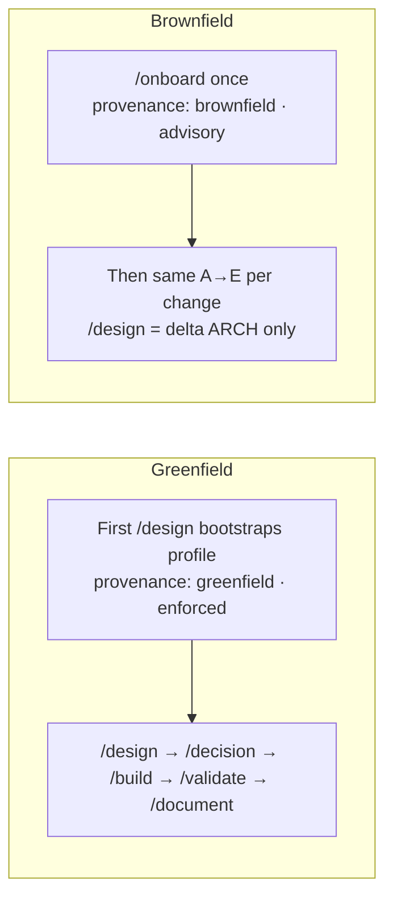
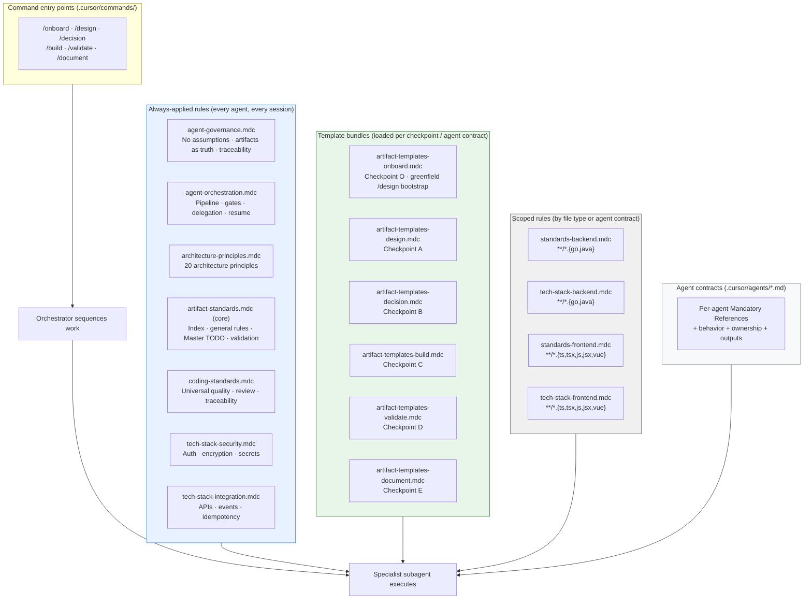
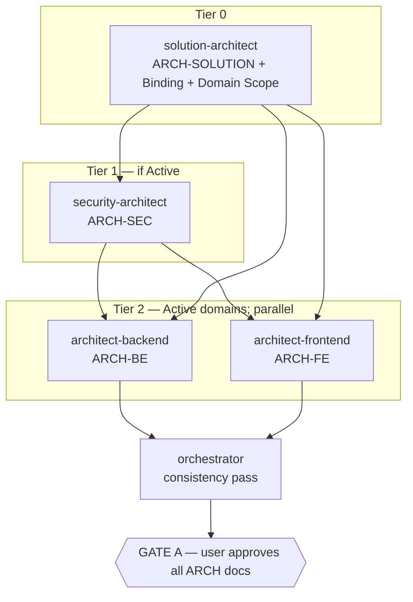
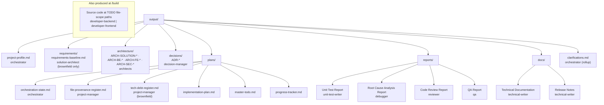

# SDLC Pipeline — Visual Reference

Presentation-oriented diagrams for the checkpoint-driven SDLC pipeline. Authoritative contracts: `.cursor/rules/agent-governance.mdc`, `.cursor/rules/agent-orchestration.mdc`, and `.cursor/agents/orchestrator.md`. For command details see `.cursor/workflow.md`; for ASCII flow see `.cursor/sdlc-flow.txt`.

**How to export:** paste any Mermaid block into [Mermaid Live Editor](https://mermaid.live) and export PNG or SVG for slides.

---

## 1. End-to-end pipeline

Commands are **start buttons, not approve buttons**. Every gate requires explicit human approval before the next checkpoint.

```mermaid
flowchart TB
    subgraph ENTRY["Every run starts here"]
        U["User prompt / command"]
        O["Orchestrator (main chat agent)"]
        U --> O
        O --> R1["Read project-profile.md"]
        R1 --> R2["Read orchestration-state.md"]
        R2 --> R3["Read file-provenance-register.md<br/>(+ tech-debt-register if brownfield)"]
    end

    subgraph BROWN["Brownfield only — run once"]
        CMD_O["/onboard — Checkpoint O"]
        A_O["orchestrator + architects +<br/>decision-manager + project-manager"]
        OUT_O["project-profile.md<br/>as-built ARCH-*<br/>retrospective ADR-*<br/>requirements-baseline.md<br/>file-provenance-register.md<br/>tech-debt-register.md"]
        GATE_O{{"GATE O — user approves onboard"}}
        CMD_O --> A_O --> OUT_O --> GATE_O
    end

    subgraph CORE["Change work — greenfield and brownfield"]
        CMD_A["/design — Checkpoint A"]
        A_A["orchestrator → solution-architect (Tier 0)<br/>→ security-architect if Active (Tier 1)<br/>→ BE/FE parallel if Active (Tier 2)<br/>→ consistency pass"]
        OUT_A["project-profile.md (bootstrap if greenfield)<br/>ARCH-SOLUTION-* (Binding, Delegated, Domain Scope)<br/>ARCH-SEC-* · ARCH-BE-* · ARCH-FE-* (Active domains)"]
        GATE_A{{"GATE A — approve all architecture docs<br/>(draft-complete between tiers)"}}

        CMD_B["/decision — Checkpoint B"]
        A_B["decision-manager + project-manager"]
        OUT_B["net-new ADR-*<br/>implementation-plan.md<br/>master-todo.md<br/>progress-tracker.md"]
        GATE_B{{"GATE B — approve ADRs + plan"}}

        CMD_C["/build — Checkpoint C"]
        A_C["developer-backend | developer-frontend → project-manager (register) →<br/>unit-test-writer → debugger (if needed)"]
        OUT_C["Source code<br/>file-provenance-register rows<br/>Unit Test Report"]
        GATE_C{{"GATE C — TODO(s) completed + register updated"}}

        CMD_D["/validate — Checkpoint D"]
        A_D["reviewer + qa"]
        OUT_D["Code Review Report<br/>QA Report (Go / No-Go)"]
        GATE_D{{"GATE D — review + QA sign-off<br/>(No-Go → /build)"}}

        CMD_E["/document — Checkpoint E"]
        A_E["technical-writer"]
        OUT_E["Technical docs<br/>Release notes"]
        GATE_E{{"GATE E — approve docs"}}

        CMD_A --> A_A --> OUT_A --> GATE_A
        GATE_A --> CMD_B --> A_B --> OUT_B --> GATE_B
        GATE_B --> CMD_C --> A_C --> OUT_C --> GATE_C
        GATE_C --> CMD_D --> A_D --> OUT_D --> GATE_D
        GATE_D --> CMD_E --> A_E --> OUT_E --> GATE_E
    end

    DEL["Delivery"]

    R3 --> PATH{"Brownfield and<br/>Checkpoint O not approved?"}
    PATH -->|Yes| CMD_O
    PATH -->|No| CMD_A
    GATE_O --> CMD_A
    GATE_E --> DEL

    style GATE_O fill:#fff3cd,stroke:#856404
    style GATE_A fill:#fff3cd,stroke:#856404
    style GATE_B fill:#fff3cd,stroke:#856404
    style GATE_C fill:#fff3cd,stroke:#856404
    style GATE_D fill:#fff3cd,stroke:#856404
    style GATE_E fill:#fff3cd,stroke:#856404
    style DEL fill:#d4edda,stroke:#155724
```

---

## 2. Greenfield vs brownfield

| Type | `provenance` | `enforcement_mode` | First step |
|------|--------------|--------------------|------------|
| Greenfield | `greenfield` | `enforced` | `/design` (bootstraps profile) |
| Brownfield | `brownfield` | `advisory` | `/onboard` once, then `/design` per change |

---

## 3. Rules injected (governance layer)

### Rules per agent

| Agent | Always rules | Additional rules |
|-------|--------------|------------------|
| **orchestrator** | governance, orchestration, architecture-principles, artifact-standards (core) | template bundles per checkpoint (onboard, design, decision; build/validate/document when delegating) |
| **solution-architect** | governance, artifact-standards (core), architecture-principles | onboard + design bundles; integration (topology only — not backend/frontend/security stack) |
| **architect-backend** | governance, artifact-standards (core), architecture-principles, coding-standards | design bundle; standards-backend, backend, integration |
| **architect-frontend** | governance, artifact-standards (core), architecture-principles, coding-standards | design bundle; standards-frontend, frontend, integration |
| **security-architect** | governance, artifact-standards (core), architecture-principles, coding-standards | design bundle; security, integration |
| **decision-manager** | governance, artifact-standards (core), architecture-principles | onboard + decision bundles |
| **project-manager** | governance, artifact-standards (core), architecture-principles | onboard + decision bundles |
| **developer-backend** | governance, coding-standards, architecture-principles, artifact-standards (core), integration, security | standards-backend, backend |
| **developer-frontend** | governance, coding-standards, architecture-principles, artifact-standards (core), integration, security | standards-frontend, frontend |
| **unit-test-writer** | governance, coding-standards, architecture-principles, artifact-standards (core), integration, security | build bundle; standards-backend or standards-frontend by TODO scope |
| **debugger** | same as unit-test-writer | build bundle; standards-backend or standards-frontend by TODO scope |
| **reviewer** | same as developer-backend / developer-frontend (by routed TODO stack) | validate bundle; standards-backend or standards-frontend + backend or frontend tech-stack (by file type) |
| **qa** | same as unit-test-writer | validate bundle; standards-* resolved from TODO file scope |
| **technical-writer** | same as unit-test-writer | document bundle |

---

## 4. Agents per checkpoint

```mermaid
flowchart LR
    subgraph O["Checkpoint O — /onboard"]
        o1[orchestrator]
        o2[solution-architect]
        o3[architect-backend]
        o4[architect-frontend]
        o5[security-architect]
        o6[decision-manager]
        o7[project-manager]
    end

    subgraph A["Checkpoint A — /design"]
        a1[orchestrator]
        a2[solution-architect]
        a3[architect-backend]
        a4[architect-frontend]
        a5[security-architect]
    end

    subgraph B["Checkpoint B — /decision"]
        b1[decision-manager]
        b2[project-manager]
    end

    subgraph C["Checkpoint C — /build"]
        c1[developer-backend]
        c1b[developer-frontend]
        c2[project-manager]
        c3[unit-test-writer]
        c4[debugger]
    end

    subgraph D["Checkpoint D — /validate"]
        d1[reviewer]
        d2[qa]
    end

    subgraph E["Checkpoint E — /document"]
        e1[technical-writer]
    end

    O --> A --> B --> C --> D --> E
```

### Checkpoint A — tiered `/design`

Intra-checkpoint stages use **draft-complete** gates (required sections present; user approval once at Checkpoint A end). Skip Tier 1 when Domain Scope **security** = `Cancelled`; skip Tier 2 domains marked `Cancelled`.

At Checkpoint C, orchestrator routes each TODO to **one** of `developer-backend` or `developer-frontend` (never both in one TODO). `debugger` at Checkpoint C is **conditional** on failures requiring root-cause analysis.

---

## 5. Artifacts created

Provenance is **not** stored in source-code file headers. Authoritative registers: `project-profile.md`, `file-provenance-register.md`, `tech-debt-register.md`.

---

## 6. Checkpoint summary

| Command | Checkpoint | Agents | Key outputs | Gate |
|---------|------------|--------|-------------|------|
| `/onboard` | O | orchestrator, architects, decision-manager, project-manager | profile, as-built ARCH-*, retrospective ADR-*, registers, requirements-baseline | User approves onboard artifacts |
| `/design` | A | orchestrator, architects (tiered: solution → security if Active → BE/FE parallel if Active → consistency pass) | profile (bootstrap), ARCH-SOLUTION (Binding, Delegated, Domain Scope), Active domain ARCH-* | User approves all architecture docs (single gate) |
| `/decision` | B | decision-manager, project-manager | ADR-*, plan artifacts | User approves ADRs + plan |
| `/build` | C | developer-backend / developer-frontend, project-manager, unit-test-writer, debugger | source code, register rows, unit tests + report | TODO(s) completed + register updated |
| `/validate` | D | reviewer, qa | review + QA reports | User sign-off (No-Go → `/build`) |
| `/document` | E | technical-writer | docs + release notes | User approves docs |

---

## Suggested slide order

1. End-to-end pipeline (section 1)
2. Greenfield vs brownfield (section 2)
3. Rules injected (section 3)
4. Agents per checkpoint (section 4)
5. Artifacts created (section 5)
6. Checkpoint summary table (section 6)

---

## Related documents

| Document | Purpose |
|----------|---------|
| `.cursor/workflow.md` | Human-facing command reference |
| `.cursor/sdlc-flow.txt` | Compact ASCII pipeline |
| `.cursor/agents/orchestrator.md` | Orchestrator contract + resume protocol |
| `.cursor/rules/agent-orchestration.mdc` | Pipeline gates and delegation map |
| `.cursor/rules-index.md` | Master index of all rules and sections |
| `.cursor/rules/artifact-standards.mdc` | Core artifact index, general rules, Master TODO, validation |
| `.cursor/rules/artifact-templates/*.mdc` | Per-checkpoint artifact templates (loaded on demand) |
| `.cursor/CHANGELOG.md` | Version history |
