> **Status dokumen: USULAN, belum dikonfirmasi Bang Jerry.** Ini adalah `[ERD] catalog v2.0` (acuan resmi saat ini, isinya identik dengan `combined-erd.mmd`) ditambah 6 usulan yang muncul dari pengerjaan UI Katalog Tindakan & Kelola Asuransi. Setiap field/tabel baru ditandai komentar `RENCANA v3.0` supaya jelas mana yang sudah live dan mana yang masih usulan. Jangan dianggap final sampai di-ACC.
>
> Ringkasan 6 usulan di file ini:
> 1. `master_prices.price_tier` — dukung harga bertingkat (Tier 1/2/3).
> 2. `insurance_rules.percentage_tier_reference` + `alternative_group_id` — dukung aturan asuransi tipe Percentage yang butuh acuan tier, dan aturan yang jadi alternatif (pilih salah satu).
> 3. `insurance_providers.status` (ganti dari `is_active`) + `special_price_code` — dukung 4 status (Berlaku/Tidak Berlaku/Belum Berlaku/Harga Khusus) dan kode harga khusus. Statusnya per baris = per kombinasi provider+cabang (tabel ini sudah satu baris per cabang), jadi bisa beda-beda per cabang untuk provider yang sama — bukan cuma on/off global seperti `is_active` sekarang.
> 4. `branch_price_tiers` (tabel baru) — tier harga tiap cabang ditentukan **otomatis**, bukan dipilih manual per transaksi, dan **bisa berubah seiring waktu** (linimasa `effective_from`/`effective_to`, sama seperti `master_prices`). Kedua keputusan ini sudah dikonfirmasi user.
> 5. `insurance_rules.status` — kolom baru, AKTIF/NONAKTIF per aturan klaim, kontrol manual independen dari tanggal (misal mau bekukan sementara aturan yang lagi disengketakan, tanpa ubah tanggal resminya).
> 6. `master_prices.status` — kolom baru, AKTIF/NONAKTIF, pola sama persis dengan usulan #5. **Ini jawaban dari catatan konsistensi yang sempat terbuka**: user memutuskan supaya konsisten, `master_prices` juga dikasih kolom status manual yang sama, bukan dibiarkan beda dari `insurance_rules`.

```mermaid
erDiagram

    catalog_services {
        uuid id PK "DEFAULT gen_random_uuid()"
        uuid tenant_id "plain UUID dari JWT, bukan FK"
        varchar code UK "unik per tenant"
        varchar name "NOT NULL"
        varchar category "PERIODONSIA / KONSERVASI / BEDAH_MULUT / PEDODONSIA / ORTHODONTIA / PROSTODONSIA / OBAT / BAHAN"
        varchar sub_category "PARTIAL_DENTURE / FULL_DENTURE / FIXED_DENTURE / RESTORASI / LAIN_LAIN, NULL kecuali Prostodonsia"
        varchar unit "BUTIR / BOTOL / PCS / PACK, NULL untuk tindakan, wajib untuk OBAT dan BAHAN"
        integer dp_min_percent "NULL = tidak perlu DP, 50 = DP minimal 50 persen untuk Behel dan Gigi Tiruan"
        text description "keterangan klinis dari pricelist"
        boolean is_active "DEFAULT TRUE"
        timestamptz created_at "DEFAULT NOW()"
        uuid created_by
        timestamptz updated_at "DEFAULT NOW()"
        uuid updated_by
        timestamptz deleted_at "NULL = belum dihapus"
        uuid deleted_by
    }

    master_prices {
        uuid id PK "DEFAULT gen_random_uuid()"
        uuid tenant_id "plain UUID dari JWT, bukan FK"
        uuid catalog_service_id FK "references catalog_services.id"
        varchar price_tier "RENCANA v3.0 - TIER_1 / TIER_2 / TIER_3, Tier 1 = harga utama. Unique constraint jadi (tenant_id, catalog_service_id, price_tier, effective period)"
        decimal amount "harga normal, NOT NULL"
        char currency "ISO 4217, contoh IDR"
        varchar status "RENCANA v3.0 - AKTIF / NONAKTIF. Kontrol manual, independen dari effective_from/effective_to, sama pola dengan insurance_rules.status. Ditambah supaya konsisten: dulu master_prices cuma dihitung dari tanggal, tidak ada cara 'bekukan sementara' tanpa ubah tanggal resmi (misal harga salah input, mau ditahan dulu tanpa buru-buru ganti effective_to)"
        timestamptz effective_from "kapan harga mulai berlaku"
        timestamptz effective_to "NULL = harga masih aktif secara tanggal (lihat status untuk kontrol manual)"
        timestamptz created_at "DEFAULT NOW()"
        uuid created_by
        timestamptz updated_at "DEFAULT NOW()"
        uuid updated_by
        timestamptz deleted_at "NULL = belum dihapus"
        uuid deleted_by
    }

    branch_price_tiers {
        uuid id PK "DEFAULT gen_random_uuid() - RENCANA v3.0, tabel baru"
        uuid tenant_id "plain UUID dari JWT, bukan FK"
        uuid branch_id "plain UUID dari JWT, bukan FK, referensi ke branch di master-data-service"
        varchar price_tier "RENCANA v3.0 - TIER_1 / TIER_2 / TIER_3, tier yang berlaku untuk cabang ini pada periode effective_from-to"
        timestamptz effective_from "RENCANA v3.0 - kapan tier ini mulai berlaku untuk cabang ini. Sudah dikonfirmasi user: tier per cabang BISA berubah seiring waktu, jadi butuh linimasa (pola sama seperti master_prices), bukan cuma 1 baris tetap per cabang"
        timestamptz effective_to "RENCANA v3.0 - NULL = tier ini masih berlaku. Unique constraint jadi (tenant_id, branch_id, effective period), bukan lagi unique per (tenant_id, branch_id) begitu saja"
        timestamptz created_at "DEFAULT NOW()"
        uuid created_by
        timestamptz updated_at "DEFAULT NOW()"
        uuid updated_by
        timestamptz deleted_at "NULL = belum dihapus"
        uuid deleted_by
    }

    insurance_providers {
        uuid id PK "DEFAULT gen_random_uuid()"
        uuid tenant_id "plain UUID dari JWT, bukan FK"
        uuid branch_id "plain UUID dari JWT, bukan FK, satu baris per cabang"
        varchar code UK "unik per tenant dan branch, contoh BRILIFE"
        varchar name "NOT NULL, contoh BRILIFE"
        varchar status "RENCANA v3.0 - GANTI dari is_active (boolean). Isi: BERLAKU / TIDAK_BERLAKU / BELUM_BERLAKU / HARGA_KHUSUS. Statusnya PER BARIS (per provider+cabang), bukan global per provider - karena tabel ini sudah satu baris per cabang, jadi bisa saja mis. BRILIFE = BERLAKU di cabang lain tapi TIDAK_BERLAKU khusus di cabang Veteran. Alasan ganti dari is_active: booleannya cuma 2 keadaan, data asli butuh 4"
        varchar special_price_code "RENCANA v3.0 - nullable, kode harga khusus (contoh NAYAKA, InovaCare), diisi kalau status = HARGA_KHUSUS"
        timestamptz created_at "DEFAULT NOW()"
        uuid created_by
        timestamptz updated_at "DEFAULT NOW()"
        uuid updated_by
        timestamptz deleted_at "NULL = belum dihapus"
        uuid deleted_by
    }

    insurance_rules {
        uuid id PK "DEFAULT gen_random_uuid()"
        uuid tenant_id "plain UUID dari JWT, bukan FK"
        uuid branch_id "plain UUID dari JWT, bukan FK"
        uuid insurance_provider_id FK "references insurance_providers.id"
        uuid catalog_service_id FK "references catalog_services.id, NULL = rule global berlaku semua item"
        varchar pricing_type "FIXED atau PERCENTAGE"
        decimal pricing_value "nominal jika FIXED, persen jika PERCENTAGE"
        decimal coverage_percent "porsi ditanggung penjamin, NULL = 100 persen"
        decimal coverage_max "plafon per item, NULL = tanpa batas"
        varchar percentage_tier_reference "RENCANA v3.0 - nullable, tier acuan kalau pricing_type=PERCENTAGE. NULL = pakai default tenant (saat ini TIER_3, sudah diputuskan)"
        uuid alternative_group_id "RENCANA v3.0 - nullable, rule dengan group_id sama untuk insurance_provider_id+catalog_service_id yang sama dianggap alternatif (pilih salah satu, spt kasus Prudential). NULL = rule berdiri sendiri"
        varchar status "RENCANA v3.0 - AKTIF / NONAKTIF. Kontrol manual, independen dari effective_from/effective_to. Sekarang konsisten dengan master_prices.status (usulan #6) - keduanya pakai pola yang sama"
        timestamptz effective_from
        timestamptz effective_to "NULL = masih berlaku"
        timestamptz created_at "DEFAULT NOW()"
        uuid created_by
        timestamptz updated_at "DEFAULT NOW()"
        uuid updated_by
        timestamptz deleted_at "NULL = belum dihapus"
        uuid deleted_by
    }

    discount_programs {
        uuid id PK "DEFAULT gen_random_uuid()"
        uuid tenant_id "plain UUID dari JWT, bukan FK"
        varchar program_type "PROMO atau VOUCHER"
        varchar code UK "unik per tenant, contoh HAPPYHOUR atau CFD50K"
        varchar name "NOT NULL"
        text description
        varchar eligibility_anchor "BOOKING_TIME / CHECKIN_TIME / PAYMENT_TIME, penentu promo gugur atau tidak"
        integer usage_limit "NULL untuk PROMO, wajib untuk VOUCHER"
        integer usage_count "DEFAULT 0, counter redemption voucher"
        timestamptz starts_at "awal kampanye"
        timestamptz ends_at "akhir kampanye"
        boolean is_active "DEFAULT TRUE"
        timestamptz created_at "DEFAULT NOW()"
        uuid created_by
        timestamptz updated_at "DEFAULT NOW()"
        uuid updated_by
        timestamptz deleted_at "NULL = belum dihapus"
        uuid deleted_by
    }

    discount_schedules {
        uuid id PK "DEFAULT gen_random_uuid()"
        uuid tenant_id "plain UUID dari JWT, bukan FK"
        uuid discount_program_id FK "references discount_programs.id"
        varchar days_of_week "contoh 2,3,4,5 untuk Selasa sampai Jumat"
        time start_time "contoh 09:00"
        time end_time "contoh 13:00"
        integer grace_minutes "toleransi keterlambatan, contoh 10 menit"
        timestamptz created_at "DEFAULT NOW()"
        uuid created_by
        timestamptz updated_at "DEFAULT NOW()"
        uuid updated_by
        timestamptz deleted_at "NULL = belum dihapus"
        uuid deleted_by
    }

    discount_rules {
        uuid id PK "DEFAULT gen_random_uuid()"
        uuid tenant_id "plain UUID dari JWT, bukan FK"
        uuid discount_program_id FK "references discount_programs.id"
        uuid catalog_service_id FK "references catalog_services.id"
        varchar discount_type "FIXED atau PERCENTAGE"
        decimal discount_value "nominal potongan atau persentase"
        decimal max_discount "batas maksimum potongan untuk PERCENTAGE, NULL = tanpa batas"
        decimal min_subtotal "syarat minimum belanja, NULL = tanpa syarat"
        timestamptz effective_from
        timestamptz effective_to "NULL = masih berlaku"
        timestamptz created_at "DEFAULT NOW()"
        uuid created_by
        timestamptz updated_at "DEFAULT NOW()"
        uuid updated_by
        timestamptz deleted_at "NULL = belum dihapus"
        uuid deleted_by
    }

    discount_branches {
        uuid id PK "DEFAULT gen_random_uuid()"
        uuid tenant_id "plain UUID dari JWT, bukan FK"
        uuid discount_program_id FK "references discount_programs.id"
        uuid branch_id "plain UUID dari JWT, bukan FK"
        boolean is_applicable "DEFAULT TRUE, FALSE = cabang ini tidak dapat promo, tidak ada baris = berlaku semua cabang"
        timestamptz created_at "DEFAULT NOW()"
        uuid created_by
        timestamptz updated_at "DEFAULT NOW()"
        uuid updated_by
        timestamptz deleted_at "NULL = belum dihapus"
        uuid deleted_by
    }

    discount_grants {
        uuid id PK "DEFAULT gen_random_uuid()"
        uuid tenant_id "plain UUID dari JWT, bukan FK"
        uuid branch_id "plain UUID dari JWT, bukan FK"
        uuid profile_id "referensi patient service, bukan FK"
        uuid granted_by "dokter pemberi diskon prerogatif"
        varchar reason "VIP / EMPLOYEE_FAMILY / BUNDLED_PROCEDURE / LOYAL"
        varchar discount_type "FIXED atau PERCENTAGE"
        decimal discount_value "nominal atau persentase"
        uuid consent_document_id "bukti informed consent, referensi cross service, bukan FK"
        uuid approved_by "kasir yang memvalidasi"
        timestamptz approved_at
        timestamptz created_at "DEFAULT NOW()"
        uuid created_by
        timestamptz updated_at "DEFAULT NOW()"
        uuid updated_by
        timestamptz deleted_at "NULL = belum dihapus"
        uuid deleted_by
    }

    price_quotes {
        uuid id PK "DEFAULT gen_random_uuid()"
        uuid tenant_id "plain UUID dari JWT, bukan FK"
        uuid branch_id "plain UUID dari JWT, bukan FK"
        uuid profile_id "referensi patient service, bukan FK"
        uuid appointment_id "referensi appointment service, bukan FK"
        uuid checkout_session_id UK "unik per tenant dan branch"
        timestamptz booked_at "snapshot waktu booking, basis evaluasi kelayakan promo"
        uuid insurance_provider_id "NULL = pasien umum, referensi insurance_providers.id"
        char currency "ISO 4217"
        decimal subtotal "total harga normal sebelum penyesuaian"
        decimal total_adjustment "jumlah seluruh potongan dari quote_adjustments"
        decimal insurance_covered "porsi ditanggung penjamin"
        decimal patient_payable "sisa dibayar pasien, co-payment"
        varchar status "DRAFT / CONFIRMED / EXPIRED / VOID"
        timestamptz expires_at
        timestamptz created_at "DEFAULT NOW()"
        uuid created_by
        timestamptz updated_at "DEFAULT NOW()"
        uuid updated_by
    }

    price_quote_items {
        uuid id PK "DEFAULT gen_random_uuid()"
        uuid tenant_id "plain UUID dari JWT, bukan FK"
        uuid branch_id "plain UUID dari JWT, bukan FK"
        uuid price_quote_id FK "references price_quotes.id"
        uuid catalog_service_id "snapshot referensi, bukan FK"
        uuid master_price_id "harga yang dipakai saat transaksi"
        varchar item_name "snapshot nama item saat transaksi"
        varchar price_tier_used "RENCANA v3.0 - snapshot tier (TIER_1/2/3) yang dipakai saat transaksi, buat audit"
        decimal quantity
        decimal unit_price "harga satuan saat transaksi"
        decimal subtotal "quantity dikali unit_price"
        decimal total_adjustment "jumlah potongan untuk item ini"
        decimal insurance_covered
        decimal patient_payable
        timestamptz created_at "DEFAULT NOW()"
        uuid created_by
        timestamptz updated_at "DEFAULT NOW()"
        uuid updated_by
    }

    quote_adjustments {
        uuid id PK "DEFAULT gen_random_uuid()"
        uuid tenant_id "plain UUID dari JWT, bukan FK"
        uuid price_quote_item_id FK "references price_quote_items.id"
        varchar source_type "PROMO / VOUCHER / DOCTOR / INSURANCE"
        uuid source_id "id discount_rules atau discount_grants atau insurance_rules yang dipakai"
        decimal amount "nominal potongan, negatif untuk pengurangan"
        integer apply_order "urutan penerapan, 1 diterapkan lebih dulu"
        timestamptz created_at "DEFAULT NOW()"
        uuid created_by
    }

    catalog_services ||--o{ master_prices : "catalog_service_id"
    catalog_services ||--o{ insurance_rules : "catalog_service_id"
    catalog_services ||--o{ discount_rules : "catalog_service_id"

    insurance_providers ||--o{ insurance_rules : "insurance_provider_id"

    discount_programs ||--o{ discount_schedules : "discount_program_id"
    discount_programs ||--o{ discount_rules : "discount_program_id"
    discount_programs ||--o{ discount_branches : "discount_program_id"

    price_quotes ||--o{ price_quote_items : "price_quote_id"
    price_quote_items ||--o{ quote_adjustments : "price_quote_item_id"
```

---

## Keputusan: cara sistem/kasir menentukan tier yang berlaku untuk satu transaksi

**Otomatis dari cabang** — sudah dikonfirmasi user. Tiap cabang "ditugaskan" ke satu tier tertentu lewat tabel baru `branch_price_tiers` (`branch_id` plain UUID + `price_tier`), karena `branches` ada di master-data-service dan modelnya sekarang tidak punya field tier — jadi butuh tabel terpisah di catalog-service, bukan kolom baru di service lain.

Alurnya: saat transaksi, sistem lookup `branch_price_tiers` pakai `branch_id` dari quote DAN waktu transaksi (cari baris yang `effective_from` ≤ waktu transaksi ≤ `effective_to`/NULL) → dapat `price_tier` cabang itu pada periode tersebut → dipakai buat cari harga di `master_prices` (yang tier-nya cocok) → hasil tier yang dipakai disimpan sebagai snapshot di `price_quote_items.price_tier_used` (untuk audit, harga tidak berubah kalau tier cabang berubah di kemudian hari).

**Sudah diputuskan (dikonfirmasi user):** 1 cabang BISA punya tier yang berubah-ubah seiring waktu — `branch_price_tiers` pakai `effective_from`/`effective_to`, pola linimasa yang sama seperti `master_prices`, bukan lagi 1 baris tetap per cabang.

## Klarifikasi: diskon 12% BRILIFE BUKAN bagian dari `insurance_rules`

Sempat ada kerancuan karena `insurance_rules.pricing_value` contoh awalnya pakai "12% BRILIFE" — ini **sudah dikoreksi (dihapus dari contoh field di atas)**. Sudah dikonfirmasi final oleh tim operasional (bukan lagi asumsi): diskon 12% BRILIFE itu **potongan revenue dokter**, diterapkan manual oleh CRO saat menyusun laporan harian revenue dokter — bukan potongan harga/klaim yang dihitung ke pasien lewat `insurance_rules`.

Karena ini domain "revenue/komisi dokter", bukan domain harga-ke-pasien, **tidak ada tabel/kolom yang diusulkan di dokumen ini untuk menampungnya** — belum ada representasi skema untuk domain ini sama sekali di ERD manapun yang pernah dibaca (bukan cuma belum ada di catalog-service). Kalau nanti proses ini mau diotomatisasi di sistem (bukan cuma catatan manual CRO), itu kemungkinan besar perlu modul/service baru di luar scope catalog-service — perlu didiskusikan dengan Bang Jerry, belum ada usulan konkret di titik ini.

## Ringkasan tabel yang TIDAK berubah dari v2.0

`catalog_services`, `discount_programs`, `discount_schedules`, `discount_rules`, `discount_branches`, `discount_grants`, `price_quotes`, `quote_adjustments` — tidak ada perubahan yang diusulkan di dokumen ini.
